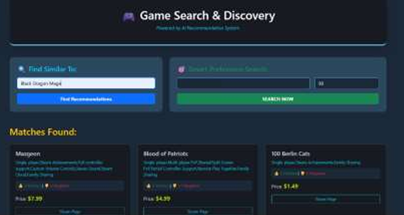
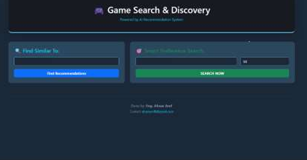
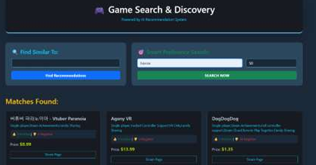

# Steam Intelligent Game Recommender System (NLP & Flask)


> **An end-to-end semantic game discovery and recommendation engine analyzing 122,611 Steam titles using TF-IDF vectorization and Cosine Similarity, deployed via a responsive Flask & Bootstrap 5 web application.**



---

## 📄 Full Technical Report & Code
- 📑 **[View / Download Complete Technical Report (PDF)](docs/Steam_AI_Recommender_Report.pdf)**
- 📓 **[Explore Data Pipeline & Model Evaluation (`games.ipynb`)](games.ipynb)**
- ⚙️ **[Inspect Flask Inference Server (`app.py`)](app.py)**

---

## 🎯 Project Overview
With over a hundred thousand titles on Steam, traditional keyword search fails to capture semantic similarity between games. This project implements a full data-to-deployment pipeline that cleans and indexes **122,611 game records**, builds a pre-computed **TF-IDF vector space**, and serves sub-second recommendations through two interactive discovery modes:
1. **Semantic Similarity Search (`/recommend`):** Finds the top 6 most similar games using Cosine Similarity over combined genres, tags, categories, and game descriptions.
2. **Smart Preference Filter (`/predict_preference`):** Combines budget constraints (`Price <= max_price`) with flexible keyword/genre matching and displays community sentiment (positive vs. negative reviews).

- **Institution:** Saba University — Faculty of Engineering (Mechatronics Engineering)
- **Author:** Afnan Aref
- **Supervision:** Dr. Yahya Al-Naggar & Eng. Osama

---

## 📊 Dataset & Model Performance Metrics
Extracted directly from the Jupyter evaluation pipeline (`games.ipynb`):

| Metric | Value |
| :--- | :---: |
| **Raw Dataset Size** | `122,611` games × `39` features (`572.28 MB`) |
| **Cleaned Indexed Dataset** | `113,658` games × `25` features |
| **TF-IDF Matrix Dimensions** | `(113,658 × 5,000)` sparse feature vectors |
| **Global Content Similarity Score** | **87.12%** *(evaluated across 92 sampled games)* |
| **Sample Query Benchmark** (*Black Dragon Mage*) | **71.27%** avg. top-10 match score |

---

## 🖥️ Web Application Showcase
| Main Discovery Interface | Smart Preference & Budget Search |
| :---: | :---: |
|  |  |

---

## 🚀 How to Run Locally
> *Note: Large data artifacts (`final_games_data.csv` ~376 MB and `tfidf_matrix.pkl` ~17 MB) are excluded from Git tracking. Follow the steps below to regenerate them locally.*

1. **Clone the repository and install dependencies:**
   ```bash
   git clone [https://github.com/an02-7/Steam-AI-Game-Recommender.git](https://github.com/an02-7/Steam-AI-Game-Recommender.git)
   cd Steam-AI-Game-Recommender
   pip install -r requirements.txt
